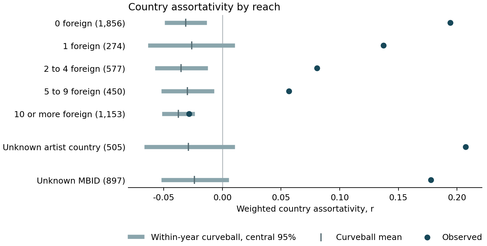

# Wikipedia reach

We used 5,712 acts at two or more festivals. Foreign reach counts Wikipedia editions outside the act's home languages, using MusicBrainz artist country and Babel's language data. We used five tiers for mapped artist countries. Zero foreign includes 1,550 acts without a linked article and 306 with an article in a home language. For most acts in this tier, the zero reflects missing Wikipedia coverage in our data. The unknown artist country group contains 504 blank country codes and 1 unmapped code, all with blank foreign counts. The 897 acts without an MBID form a match-failure group.

## Country mixing

The null in the table is within-year curveball, with 2,000 draws per year and group. It fixes each act's yearly edition count and each edition's lineup size within the group. Leeds and the pandemic years are excluded by the shared loader. Same-brand pairs are excluded from the projected statistics.

| Group | Acts | Observed r | Null r mean (SD) | Overlap O/E | Gap / expected | Years above null | r excess deletion (fixed draws) | OLS deletion, acts per pair (fixed baselines) |
|---|---:|---:|---:|---:|---:|---:|---:|---:|
| 0 foreign | 1,856 | +0.194 | -0.031 (0.009) | 1.31 | +0.46 | 9 of 9 | +0.193 to +0.258 | +0.70 to +0.95 |
| 1 foreign | 274 | +0.137 | -0.026 (0.019) | 1.42 | +0.61 | 8 of 9 | +0.148 to +0.190 | +0.14 to +0.22 |
| 2 to 4 foreign | 577 | +0.081 | -0.035 (0.012) | 1.39 | +0.58 | 9 of 9 | +0.104 to +0.127 | +0.29 to +0.42 |
| 5 to 9 foreign | 450 | +0.057 | -0.030 (0.011) | 1.32 | +0.48 | 8 of 9 | +0.064 to +0.105 | +0.21 to +0.35 |
| 10 or more foreign | 1,153 | -0.029 | -0.038 (0.007) | 1.04 | +0.09 | 5 of 9 | -0.005 to +0.030 | -0.04 to +0.26 |
| **Separate group** | | | | | | | | |
| Unknown artist country | 505 | +0.207 | -0.029 (0.020) | 1.25 | +0.38 | 8 of 8 | +0.188 to +0.287 | +0.12 to +0.18 |
| **Separate group** | | | | | | | | |
| Unknown MBID | 897 | +0.178 | -0.024 (0.015) | 1.22 | +0.32 | 8 of 9 | +0.154 to +0.226 | +0.21 to +0.29 |

The zero-foreign tier had observed r +0.194 against -0.031 under within-year curveball. The tier with 10 or more foreign editions had r -0.029 against -0.038. Same-country overlap relative to within-year curveball expectation peaked in the 1 foreign tier at 1.42. For the unknown artist country group, r is undefined in 2015 because all observed overlap was between British editions.

Each projection edge is weighted by the number of shared acts in the group. We count its weight once in each direction in the country mixing matrix and compute categorical assortativity as (diagonal share minus marginal agreement) divided by (one minus marginal agreement). The pooled estimate sums the yearly mixing matrices. We recompute r for every curveball projection. The r deletion range drops each festival's edges from the observed and shuffled projections, then recomputes observed r minus null mean r. The observed/expected ratio uses same-country pair overlap and includes pairs with zero overlap. Gap/expected divides the year and day-bin adjusted same-country contrast by that same null expectation. The raw excess has units of shared acts per pair and depends on tier lineup sizes. [Week 3, part 7](https://sunelehmann.com/socialgraphs2026-web/weeks/week3.html#mixing-patterns-do-the-important-stick-together) and [Network Atlas, section 30.2](https://www.networkatlas.eu/files/sna_book.pdf)

Country assortativity captures whether more of the shared-act edge weight falls within countries than the weighted country marginals imply. It misses which booking decisions and genres produce those ties. The ratios capture the size of overlap and the adjusted gap relative to the tier baseline. They miss differences between individual festivals within a tier.

The horizontal bands show the central 95% of pooled curveball r draws. The null means are below zero for these loopless projections. The shuffle can place a shared act only on distinct editions, while the marginal agreement in r allows independently drawn edge ends. The bands use draws from one post-burn-in state per year and omit variation across such states. The fixed-draw r deletion removes a festival's edges from every observed and shuffled projection. The fixed-baseline OLS deletion refits the gap after dropping its pairs and uses the original pair expectations. [Yearly r and null spread](assortativity_yearly.csv) · [Raw gap per pair](country_gap.csv)

## One-country share

The table uses the same within-year curveball null for both measures. We pool bookings over years and give each edition or distinct festival one vote per act. For each act we take the share in its most-played country, then average over acts. We apply both measures to every shuffled booking draw. The observed repeat-festival cohort stays fixed. [Week 3, part 6](https://sunelehmann.com/socialgraphs2026-web/weeks/week3.html#compared-to-what)

| Group | Strict tagged | Editions observed | Editions null | Distinct festivals observed | Distinct festivals null | Observed at 2 editions |
|---|---:|---:|---:|---:|---:|---:|
| 0 foreign | 31.0% | 83.2% | 76.4% | 81.4% | 75.6% | 80.1% |
| 1 foreign | 56.2% | 75.5% | 69.9% | 74.0% | 68.9% | 74.3% |
| 2 to 4 foreign | 66.7% | 72.8% | 65.7% | 70.5% | 64.9% | 73.5% |
| 5 to 9 foreign | 75.3% | 68.5% | 63.6% | 65.2% | 62.5% | 66.7% |
| 10 or more foreign | 78.5% | 62.8% | 59.7% | 59.8% | 58.6% | 65.0% |
| **Separate group** | | | | | | |
| Unknown artist country | 14.1% | 86.7% | 81.1% | 85.4% | 80.5% | 85.0% |
| **Separate group** | | | | | | |
| Unknown MBID | NA | 86.4% | 80.4% | 84.8% | 79.7% | 84.7% |

The zero-foreign tier was 6.8 percentage points above its edition-based null and 5.7 points above its distinct-festival null. The corresponding excesses for the highest foreign tier were 3.0 and 1.2 points. Its observed distinct-festival share was 59.8%, with a central null band of 57.8% to 59.5%. In the observed cohort, 40.0% of acts return to a festival in another year.

This comparison captures national booking concentration beyond the observed edition counts and lineup sizes. The yearwise shuffle has no festival memory and can change both the number of distinct festivals and the pattern of return bookings. Even with one vote per festival, it cannot distinguish a national circuit from loyalty to festivals that book the same act again. It also misses bookings outside the sample. [Share estimates and null spread](national_share.csv)

## Coverage and audit

| Group | Acts | Q-id | Any article | English |
|---|---:|---:|---:|---:|
| All matched acts | 4,815 | 58.9% | 58.1% | 54.7% |
| alias | 37 | 56.8% | 56.8% | 54.1% |
| ambiguous | 662 | 72.4% | 71.3% | 68.1% |
| clashfinder id | 879 | 75.4% | 74.6% | 72.2% |
| name | 3,237 | 51.7% | 50.9% | 47.2% |
| Strict tag status, Tagged | 2,430 | 79.9% | 79.4% | 76.6% |
| Strict tag status, Untagged | 2,385 | 37.5% | 36.4% | 32.3% |
| Any usable tag, Tagged | 3,091 | 78.3% | 77.7% | 74.8% |
| Any usable tag, Untagged | 1,724 | 24.1% | 23.0% | 18.6% |

Coverage captures how often the MusicBrainz join supplies Wikipedia evidence and how that varies with tagging. It misses unlinked articles and shares errors in the upstream act matches.

English Wikipedia covered 2,067 of 3,247 acts (63.7%) from countries with nationally official or de facto English, and 538 of 1,063 (50.6%) from other countries with a language mapping. Among acts with one article, English was the only edition for 221 of 232 in the first group and 13 of 81 in the second. Counting articles outside each act's home languages removes the automatic reach credit for a home-language article. It still reflects unequal editing and MusicBrainz linkage across language communities. [Week 7, part 7](https://sunelehmann.com/socialgraphs2026-web/weeks/week7.html#bias)

The random Q-id audit confirmed 29 of 30 identities (96.7%, 95% Wilson interval 83.3% to 99.4%). It confirmed 28 of 29 among acts with articles. The sample had 14 name matches, 12 Clashfinder ID matches, 4 ambiguous matches and zero alias matches. The clashfinder id match for `majestic` was wrong. The act key combines Kevin Christie (the house DJ billed at Tomorrowland 2023) with the roots reggae band billed as The Majestic at Victorious. This measures join precision conditional on a Q-id. The sample is too small to estimate precision by match method and misses acts without a Q-id. [Q-id audit](audit.csv)

We found a missed foreign article for 4 of 18 sampled acts in the zero-foreign tier (22.2%, 95% Wilson interval 9.0% to 45.2%). Across all 20 sampled acts with no linked article, we recovered an article of any language for 7 (35.0%, 95% Wilson interval 18.1% to 56.7%). All recovered articles existed before the crawl. We marked 0 cases uncertain. We searched across Wikipedias and checked candidate titles against festival or artist sources. This checks how often a manual search recovers an article from the no-article group. It misses articles the search did not surface and gives a wide estimate from a small draw. [Miss audit](miss_audit.csv)

The seven-page sensitivity adds the verified Wikipedia edition for each recovered act. The 0 foreign group moved from 1,856 to 1,852 acts and from r +0.1943 to +0.1942. The 1 foreign group moved from 274 to 278 acts and from r +0.1372 to +0.1379. Zero-foreign observed r was +0.194 against -0.031 under within-year curveball in that rerun. This check measures the effect of the seven documented pages and misses unsearched acts and further language editions of the recovered pages. [Recovered-page sensitivity](country_gap_recovered.csv)

We moved 22% and 45% of the 1,550 zero-foreign acts without a linked article into the one-foreign tier. We sorted act keys and drew one random order with seed 2808, rounded each count to the nearest act, and used nested samples. We reran the within-year curveball null with 2,000 draws per year for each resulting tier.

| Leakage | Acts moved | Tier | Acts | Observed r | Null mean r | r excess |
|---|---:|---|---:|---:|---:|---:|
| 22% | 341 | 0 foreign | 1,515 | +0.185 | -0.032 | +0.216 |
| 22% | 341 | 1 foreign | 615 | +0.181 | -0.028 | +0.208 |
| 45% | 698 | 0 foreign | 1,158 | +0.190 | -0.032 | +0.222 |
| 45% | 698 | 1 foreign | 972 | +0.176 | -0.029 | +0.205 |

Using unrounded estimates, the zero-minus-one difference in r excess fell from 0.062 before reassignment to 0.008 at 22% and 0.017 at 45%. The two low tiers had similar r excess in both scenarios, around +0.2 each. Both exceeded the 10-or-more tier at about +0.01, whose membership stayed fixed. This measures sensitivity to random reassignment at two specified leakage rates. It misses systematic differences in which acts lack links and the possibility that recovered acts belong in tiers above one foreign edition. The scenarios give no numerical bound on the contrast. [Leakage results](country_gap_leakage.csv)

## Methods and sensitivity

The dump contained 4,792 of 4,792 distinct MBIDs. There were 23 repeat MBID rows and 23 repeat Q-id rows across act keys. We followed 8 Wikidata redirects. Of 68 Q-ids without a language sitelink, 3 were missing from Wikidata. Direct Wikipedia URLs can recover an article without a sitelink. Five acts with several Q-ids were left unresolved. The site list contains 364 language Wikipedias. We excluded 16 closed editions, which carried 0 of the queried items. Simple English counts as a separate edition in the raw data for 610 acts. Dropping it moves 5 acts across the total-edition cutoffs (0, 1, 2 to 9, and 10 or more) and 0 across the foreign-tier cutoffs. Treating it as foreign everywhere would move 8 acts across the foreign-tier cutoffs.

Babel home languages include official, de facto official, and regional official languages. Simple English shares the home status of English. Acts with an unmapped code such as XE for Europe go in the unknown artist country group regardless of article coverage. The comparison shows the effect on counts and pooled r of dropping the majority-speaker rule and reassigning unmapped codes. It misses the languages a particular act uses.

| Group | Earlier acts | Acts | Earlier r | r |
|---|---:|---:|---:|---:|
| 0 foreign | 1,884 | 1,856 | +0.203 | +0.194 |
| 1 foreign | 294 | 274 | +0.122 | +0.137 |
| 2 to 4 foreign | 546 | 577 | +0.076 | +0.081 |
| 5 to 9 foreign | 448 | 450 | +0.056 | +0.057 |
| 10 or more foreign | 1,139 | 1,153 | -0.029 | -0.029 |
| Unknown artist country | 504 | 505 | +0.207 | +0.207 |
| Unknown MBID | 897 | 897 | +0.178 | +0.178 |

The non-English sensitivity excludes both English editions and uses 0, 1 to 4, and 5 or more non-English editions, with the two unknown groups kept separate.

| Group | Acts | Observed r | Null r mean (SD) | Overlap O/E | Gap / expected | Years above null | r excess deletion (fixed draws) | OLS deletion, acts per pair (fixed baselines) |
|---|---:|---:|---:|---:|---:|---:|---:|---:|
| 0 non-English | 1,785 | +0.173 | -0.031 (0.009) | 1.27 | +0.40 | 8 of 9 | +0.161 to +0.236 | +0.61 to +0.86 |
| 1 to 4 non-English | 880 | +0.112 | -0.030 (0.010) | 1.45 | +0.66 | 9 of 9 | +0.131 to +0.154 | +0.50 to +0.67 |
| 5 or more non-English | 1,645 | -0.000 | -0.035 (0.006) | 1.13 | +0.23 | 7 of 9 | +0.025 to +0.054 | +0.19 to +0.61 |
| **Separate group** | | | | | | | | |
| Unknown artist country | 505 | +0.207 | -0.029 (0.020) | 1.25 | +0.38 | 8 of 8 | +0.188 to +0.287 | +0.12 to +0.18 |
| **Separate group** | | | | | | | | |
| Unknown MBID | 897 | +0.178 | -0.024 (0.015) | 1.22 | +0.32 | 8 of 9 | +0.154 to +0.226 | +0.21 to +0.29 |

The same within-year curveball baseline and mixing statistics apply in this sensitivity. It checks how the result changes when English is excluded for every act. It misses whether each remaining language is local to the act. [Non-English results, including one-country shares](country_gap_non_english.csv)

The strict-match sensitivity keeps Clashfinder ID, name and alias matches and reruns the within-year curveball on those acts. The main analysis includes 662 ambiguous matches. The highest foreign-reach tier had observed r -0.039 and null mean -0.037, the smallest excess r among the five foreign tiers. This checks whether the main pattern survives a stricter join. It changes group composition and skips the Unknown MBID group. [Strict-match results](country_gap_strict.csv)

The table shows observed r minus mean within-year curveball r. The excess falls across all five tiers under each rule. The 10-or-more tier sits inside its central 95% null band under all three rules. Under the official-status rule, it exceeded the yearly null mean in 5 of 9 years. Under the official-status rule, the overlap ratio peaks at one foreign edition.

| Foreign tier | Official status | Earlier home rule | Strict matching |
|---|---:|---:|---:|
| 0 foreign | +0.226 | +0.235 | +0.239 |
| 1 foreign | +0.163 | +0.152 | +0.163 |
| 2 to 4 foreign | +0.116 | +0.111 | +0.114 |
| 5 to 9 foreign | +0.087 | +0.086 | +0.091 |
| 10 or more foreign | +0.009 | +0.009 | -0.002 |
